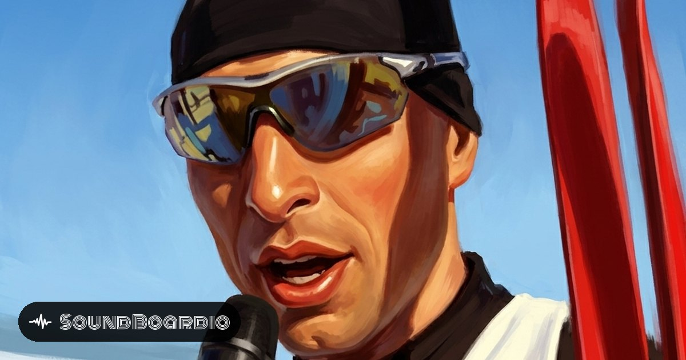

  

# Zkusit šůšn: Stanislav Řezáč

> Plugin for [SoundBoardio.com](https://soundboardio.com), a free GitHub-powered soundboard app.

22 sound quotes in a mix of Czech, English and German, playable in the browser and installable on your phone as an app.

**▶ [Open the soundboard](https://soundboardio.com/app/susn/?utm_source=github&utm_medium=readme&utm_campaign=susn)**

> Stanislav Řezáč, český dálkový běžec na lyžích, odpovídal po závodech v rozhovorech česky, anglicky a německy najednou.

Board by [Sám Život](https://www.youtube.com/watch?v=8Xm0zLDyoVQ).

## Missing a quote?

- [Suggest it](https://github.com/soundboardio/soundboardio-susn/issues/new?title=Quote%20suggestion&body=Quote%3A%0AWhere%20it%E2%80%99s%20from%20%28link%2C%20time%29%3A%0A) and say what it is and where it comes from (link, time).
- Or send a pull request: drop the mp3 into `sounds/` and add a tile to [`soundboardio.json`](soundboardio.json). A transcript in `lyrics` follows [this format](https://github.com/soundboardio/soundboardio-developers#lyrics-transcript).

## Want your own soundboard?

All it takes is a public GitHub repository and one `soundboardio.json` file. No build, no deploy, free.

Guide, generator and validator: **[soundboardio.com/create](https://soundboardio.com/create/?utm_source=github&utm_medium=readme&utm_campaign=susn)** (in Czech: [soundboardio.com/cs/create](https://soundboardio.com/cs/create/?utm_source=github&utm_medium=readme&utm_campaign=susn)).

## License

The sounds belong to the authors of the original recording; this board is a fan tribute. Is something rotten? Open an issue or [contact us](https://soundboardio.com/about/).

SoundBoardio is made by [AquaSoup](https://aquasoup.com) and is free. If it made you smile, [buy us a coffee](https://soundboardio.com/donate/?utm_source=github&utm_medium=readme&utm_campaign=susn) ☕
